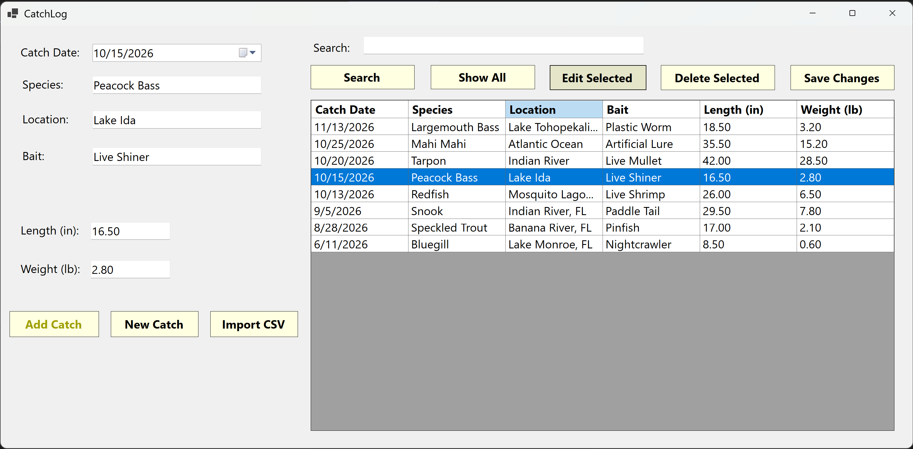
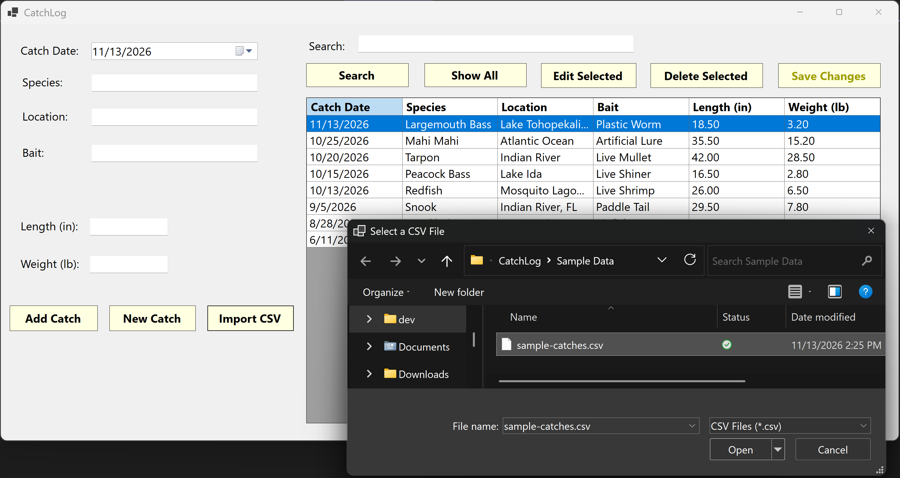

# CatchLog

A C# Windows Forms application for recording and managing fishing catches using a SQL Server database.

## About

I made CatchLog to practice C# and get more experience working with databases and Windows Forms applications.

The program lets users keep track of their fishing catches, including the species, location, bait, date, length, and weight. Catch information is saved in a SQL database so it can be viewed and updated later.

I also used this project to practice writing SQL queries, validating user input, and connecting a desktop application to a database.

## Features

- Add fishing catches with the date, species, location, bait, length, and weight
- Save catch information using SQL Server LocalDB
- View saved catches in a table
- Search catches by species or location
- Edit and update existing catches
- Delete catches with a confirmation message
- Check user input before saving, including required fields and valid measurements
- Import multiple catches from a CSV file
- Skip invalid records during CSV imports
- Keep catch information saved after closing the application

## Screenshots

### Main Application

### CSV Import

## Technologies

- C#
- .NET 10
- Windows Forms
- SQL Server LocalDB
- ADO.NET (Microsoft.Data.SqlClient)
- Visual Studio

## Setup and Running

This project requires Visual Studio with .NET desktop development support and SQL Server LocalDB.

1. Download or clone the CatchLog repository from GitHub.
2. Open the CatchLog solution in Visual Studio.
3. Make sure SQL Server LocalDB is installed.
4. Open `CatchLog/Database/Setup.sql`.
5. Connect to `(localdb)\MSSQLLocalDB` using SQL Server Object Explorer or another SQL query tool.
6. Run the `Setup.sql` script to create the `CatchLogDB` database and `Catches` table.
7. Build and run the project in Visual Studio.

The application uses a LocalDB connection to save and load catch information.

## CSV Import

CatchLog also allows users to import multiple fishing catches from a CSV file instead of entering each one manually.

To import catches:

1. Open CatchLog.
2. Click **Import CSV**.
3. Select a CSV file containing fishing records.
4. Click **Open**.

The program checks the data before saving it to the database. Valid catches are imported, and invalid rows are skipped.

A sample file is included at `Sample Data/sample-catches.csv` for testing this feature.

The CSV file should contain these columns in order:

`CatchDate,Species,Location,Bait,LengthInches,WeightPounds`

Dates should use the `YYYY-MM-DD` format, and length and weight should be positive numbers.

## Testing

I tested the application in Visual Studio to make sure the main features worked correctly.

I checked that I could:

- Add new catches and view them in the table
- Search for catches by species or location
- Edit existing catches and save the changes
- Delete catches from the database
- Enter invalid information and receive an error message
- Close and reopen the program without losing saved catches
- Import valid catches from a CSV file
- Skip invalid CSV records

## Notes

- CatchLog is a Windows desktop application.
- SQL Server LocalDB needs to be installed to use the database features.
- The database setup script and a sample CSV file are included in the project.
- The application stores fishing records locally rather than connecting to an online database.
- Importing the same CSV file more than once can create duplicate catches.